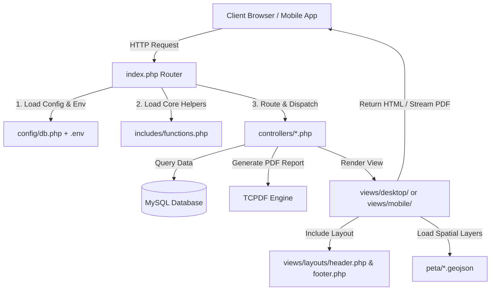

# System Architecture & Design Overview
**Project:** Hollynice Ticket System - Geopark Wonosobo  
**Stack:** Native PHP 8.2.35, MySQL/MariaDB (PDO), Tailwind CSS, OpenLayers GIS, TCPDF, PWA  
**Updated:** 2026-11-11  

---

## 1. Architectural Pattern
The application follows a **Lightweight Modular MVC (Model-View-Controller)** pattern built on native PHP without heavy framework overhead:

---

## 2. Directory Structure & Responsibilities

| Directory / File | Responsibility |
|---|---|
| [`index.php`](file:///d:/Project/E-Ticketing-Destinasi-Wisata-main/index.php) | Central Front Controller & Router; injects security headers and dispatches `$page`. |
| [`config/db.php`](file:///d:/Project/E-Ticketing-Destinasi-Wisata-main/config/db.php) | PDO database connection initialized via environment variables (`.env`). |
| [`includes/functions.php`](file:///d:/Project/E-Ticketing-Destinasi-Wisata-main/includes/functions.php) | Core helper library: `.env` loader, CSRF tokens, XSS escaping, secure file upload, session guard, currency formatting, and multi-language translations (`trans()`). |
| [`controllers/`](file:///d:/Project/E-Ticketing-Destinasi-Wisata-main/controllers/) | Business logic handling data retrieval, authentication, transaction processing, and view orchestration. |
| [`views/`](file:///d:/Project/E-Ticketing-Destinasi-Wisata-main/views/) | Presentation layer categorized into `desktop/`, `mobile/`, `admin/`, `auth/`, `monitor/`, and `layouts/`. |
| [`api/`](file:///d:/Project/E-Ticketing-Destinasi-Wisata-main/api/) | Dedicated JSON API endpoints (e.g. ticket validation). |
| [`img/`](file:///d:/Project/E-Ticketing-Destinasi-Wisata-main/img/) | Static media assets, tourism photography, products (`img/produk/`), and logos. |
| [`peta/`](file:///d:/Project/E-Ticketing-Destinasi-Wisata-main/peta/) | GeoJSON spatial dataset containing Wonosobo Regency and district boundary polygons. |
| [`TCPDF/`](file:///d:/Project/E-Ticketing-Destinasi-Wisata-main/TCPDF/) | Bundled PDF engine powering official PAD monitoring reports for BPPKAD. |
| [`setup.php`](file:///d:/Project/E-Ticketing-Destinasi-Wisata-main/setup.php) | Unified, idempotent database schema runner and data seeder (12 tables). |

---

## 3. Request-Response Lifecycle

1. **Header Injection:** `index.php` injects defensive HTTP security headers (`X-Content-Type-Options`, `X-Frame-Options`, `X-XSS-Protection`, `Referrer-Policy`).
2. **Environment & DB Bootstrapping:** `config/db.php` invokes `load_env()` to parse configuration from `.env` and boots a persistent PDO connection.
3. **Session & Security Check:** `includes/functions.php` boots session handling (with OS-agnostic temp path fallbacks) and verifies authentication / CSRF tokens when applicable.
4. **Device & Route Resolution:** If the visitor is on mobile and a mobile view exists, `isMobileDevice()` selects the mobile layout; otherwise, it serves the responsive desktop catalog view.
5. **Output Escaping & Rendering:** Views escape user inputs and render with Tailwind CSS styling and font pairing (*Plus Jakarta Sans* + *Poppins*).

---

## 4. Security Subsystem (Anti-CVE Architecture)

* **CSRF Mitigation:** `csrf_token()`, `csrf_field()`, and `verify_csrf()` enforce token matching on state-changing operations (POST and critical GET delete actions).
* **Upload Hardening:** `secure_upload_image()` verifies real file signatures via PHP `finfo` (MIME whitelist) and writes cryptographically randomized filenames (`time() . '_' . bin2hex(random_bytes(8)) . '.' . $ext`).
* **API Guard:** API endpoints mandate either an active authenticated session (Role: `operator`/`admin`) or a valid `Authorization: Bearer <API_SECRET_KEY>`.
* **Zero-Leak Policy:** Database passwords and API keys are strictly confined to `.env` and kept out of Git versioning.

