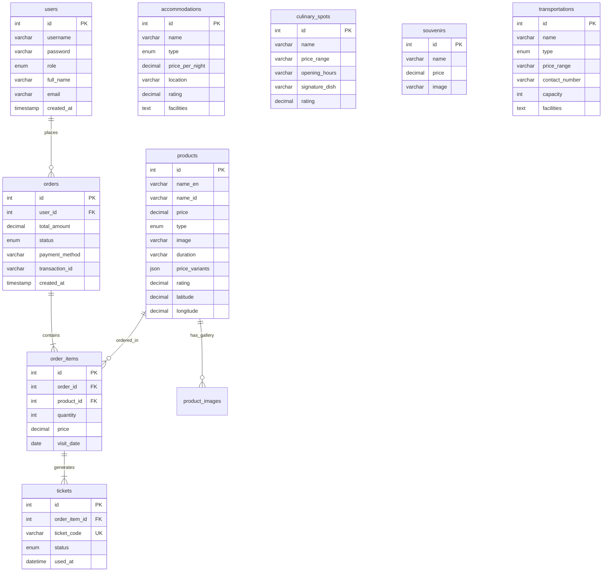

# Database Architecture & Schema Specification
**Project:** Hollynice Ticket System - Geopark Wonosobo  
**Engine:** MySQL / MariaDB (InnoDB)  
**Database Name:** `hollynice_ticket_db` (Configurable via `DB_NAME` in `.env`)  
**Runner:** [`setup.php`](file:///d:/Project/E-Ticketing-Destinasi-Wisata-main/setup.php) / `dump_geopark.sql`  
**Updated:** 2026-11-11  

---

## 1. Entity-Relationship Diagram (ERD)

---

## 2. Table Specifications

### 2.1 `users`
Manages system accounts across four distinct roles (`admin`, `operator`, `customer`, `monitor`).
* `id` INT AUTO_INCREMENT PRIMARY KEY
* `username` VARCHAR(50) NOT NULL UNIQUE
* `password` VARCHAR(255) NOT NULL (Bcrypt hashed)
* `role` ENUM('admin', 'operator', 'customer', 'monitor') DEFAULT 'customer'
* `full_name` VARCHAR(100)
* `email` VARCHAR(100)
* `created_at` TIMESTAMP DEFAULT CURRENT_TIMESTAMP

### 2.2 `products`
Catalogs tourism packages, entrance tickets, and event bookings.
* `id` INT AUTO_INCREMENT PRIMARY KEY
* `name_en` / `name_id` VARCHAR(100) NOT NULL
* `description_en` / `description_id` TEXT
* `price` DECIMAL(10,2) NOT NULL
* `type` ENUM('tour', 'entrance', 'event') NOT NULL
* `image` VARCHAR(255)
* `youtube_url` VARCHAR(255) DEFAULT NULL
* `duration` VARCHAR(100)
* `itinerary_en` / `itinerary_id` TEXT
* `facilities_en` / `facilities_id` TEXT
* `policy_en` / `policy_id` TEXT
* `rating` DECIMAL(3,1) DEFAULT 5.0
* `review_count` INT DEFAULT 0
* `latitude` DECIMAL(10,8), `longitude` DECIMAL(11,8)
* `tagline_en` / `tagline_id` VARCHAR(255)
* `event_date` / `event_end_date` DATETIME
* `price_variants` JSON
* `quota` INT DEFAULT 100

### 2.3 `product_images`
Supports multi-image photo galleries per product.
* `id` INT AUTO_INCREMENT PRIMARY KEY
* `product_id` INT NOT NULL (FK -> `products.id` ON DELETE CASCADE)
* `image_path` VARCHAR(255) NOT NULL

### 2.4 `orders`
Header table for bookings and ticket transactions.
* `id` INT AUTO_INCREMENT PRIMARY KEY
* `user_id` INT NOT NULL (FK -> `users.id`)
* `total_amount` DECIMAL(10,2) NOT NULL
* `status` ENUM('pending', 'paid', 'cancelled') DEFAULT 'pending'
* `payment_method` VARCHAR(50) (e.g. `qris`, `va_bri`, `va_bni`)
* `transaction_id` VARCHAR(100)

### 2.5 `order_items`
Individual items and visit dates associated with an order.
* `id` INT AUTO_INCREMENT PRIMARY KEY
* `order_id` INT NOT NULL (FK -> `orders.id` ON DELETE CASCADE)
* `product_id` INT NOT NULL (FK -> `products.id`)
* `quantity` INT NOT NULL
* `price` DECIMAL(10,2) NOT NULL
* `visit_date` DATE

### 2.6 `tickets`
Unique QR e-ticket tokens generated per unit of ticket purchased.
* `id` INT AUTO_INCREMENT PRIMARY KEY
* `order_item_id` INT NOT NULL (FK -> `order_items.id` ON DELETE CASCADE)
* `ticket_code` VARCHAR(50) NOT NULL UNIQUE
* `status` ENUM('valid', 'used', 'expired', 'pending_payment') DEFAULT 'pending_payment'
* `used_at` DATETIME NULL

### 2.7 `accommodations`
Hotels, homestays, and villas around Banjarnegara / Dieng.
* `id` INT AUTO_INCREMENT PRIMARY KEY
* `name` VARCHAR(255) NOT NULL
* `type` ENUM('hotel', 'homestay', 'villa') NOT NULL
* `price_per_night` DECIMAL(10,2) NOT NULL
* `location` VARCHAR(255)
* `rating` DECIMAL(2,1) DEFAULT 0
* `facilities` TEXT

### 2.8 `culinary_spots`
Local dining recommendations and culinary heritage (Dawet Ayu, Mie Ongklok).
* `id` INT AUTO_INCREMENT PRIMARY KEY
* `name` VARCHAR(255) NOT NULL
* `location` VARCHAR(255)
* `price_range` VARCHAR(100)
* `opening_hours` VARCHAR(100)
* `signature_dish` VARCHAR(255)
* `rating` DECIMAL(2,1) DEFAULT 0

### 2.9 `souvenirs`
Local handicrafts, snacks, and souvenirs ordered via WhatsApp integration.
* `id` INT AUTO_INCREMENT PRIMARY KEY
* `name` VARCHAR(255) NOT NULL
* `description` TEXT
* `price` DECIMAL(10,2) NOT NULL
* `image` VARCHAR(255)

### 2.10 `transportations`
Travel services, car rentals, and local pickup services.
* `id` INT AUTO_INCREMENT PRIMARY KEY
* `name` VARCHAR(255) NOT NULL
* `type` ENUM('rental', 'travel', 'pickup') NOT NULL
* `facilities` TEXT
* `capacity` INT DEFAULT 4
* `price_range` VARCHAR(100)
* `contact_number` VARCHAR(50)

### 2.11 `bank_sync_logs`
Automated reconciliation logs with Bank Jateng for Regional Revenue (PAD).
* `id` INT AUTO_INCREMENT PRIMARY KEY
* `order_id` INT NULL (Foreign reference to `orders.id`)
* `bank_name` VARCHAR(100) (e.g. Bank Jateng)
* `synced_at` DATETIME DEFAULT CURRENT_TIMESTAMP
* `reference` VARCHAR(100) (Unique bank transaction reference)

### 2.12 `pos_transaction_logs`
Detailed gate entry and on-site POS terminal transaction reconciliation.
* `id` INT AUTO_INCREMENT PRIMARY KEY
* `ticket_id` INT NULL (Foreign reference to `tickets.id`)
* `order_id` INT NULL
* `pos_code` VARCHAR(100) (e.g. POS-001 - Gerbang Utama)
* `payment_category` ENUM('online', 'offline') NOT NULL
* `amount` DECIMAL(15,2) NOT NULL
* `entry_type` VARCHAR(20)
* `created_at` DATETIME DEFAULT CURRENT_TIMESTAMP

### 2.13 `rate_limits`
Multi-dimensional tiered rate limiting storage (SP-014/SP-015/OWASP A07).
* `id` BIGINT UNSIGNED AUTO_INCREMENT PRIMARY KEY
* `rate_key` VARCHAR(191) NOT NULL UNIQUE
* `action` VARCHAR(32) NOT NULL ('login', 'register')
* `identifier_type` VARCHAR(32) NOT NULL ('ip', 'identifier', 'email')
* `identifier_value` VARCHAR(191) NOT NULL
* `attempts` INT UNSIGNED NOT NULL DEFAULT 1
* `tier` TINYINT UNSIGNED NOT NULL DEFAULT 1 (Tier 1..3)
* `locked_until` DATETIME NULL
* `first_attempt_at` DATETIME NOT NULL
* `last_attempt_at` DATETIME NOT NULL
* Indexes: `uniq_rate_key`, `idx_action_id`, `idx_locked_until`, `idx_last_attempt`

