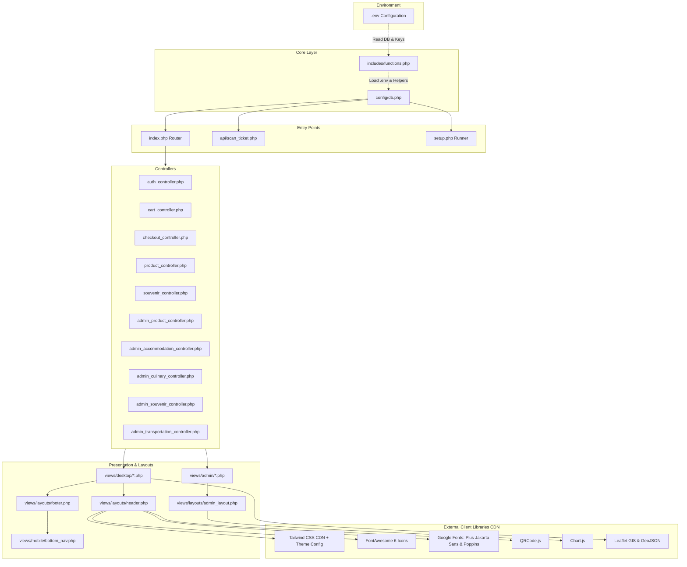

# Dependency Graph & Component Topology
**Project:** Hollynice Ticket System - Banjarnegara  
**Updated:** 2026-11-11  

---

## 1. System Dependency Topology

---

## 2. External Dependencies Breakdown

| Library / Service | Version / Source | Purpose |
|---|---|---|
| **Tailwind CSS** | CDN Runtime v3.x | Utility-first styling with custom `tailwind.config` extending brand tokens |
| **Plus Jakarta Sans** | Google Fonts | Primary font for headings, badges, and prominent callouts |
| **Poppins** | Google Fonts | Body font for user interfaces, descriptions, and forms |
| **FontAwesome** | 6.0.0 CDN | Uniform iconography throughout user and administration interfaces |
| **QRCode.js** | 1.0.0 CDN | Client-side QR generation for customer e-tickets |
| **Chart.js** | CDN Latest | Graphical visualization for Admin & Dinas Monitoring dashboards |
| **Leaflet.js** | OpenStreetMap / GeoJSON | Geographic visualization of Banjarnegara destinations and village borders |
